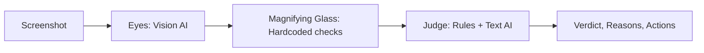

# HANNA - Your AI Cybersecurity Companion

**ForgeHacks 2026 · Cybersecurity Track**

HANNA helps you figure out if that weird text message, email, or website is actually a scam. You just upload a screenshot, and HANNA gives you a straight answer with an easy-to-read "stamp" (Safe, Suspicious, or Scam), explains why in plain English, and tells you what to do next.

We also added two cool features for the hackathon: an **AI Simulator** to train your scam-spotting skills, and a **Live Trends** dashboard to see what's going on in your area.

## Features (The 3 Tabs)

1. **Analyzer (The Core):** 
   You upload a screenshot. Our vision AI reads it, and our deterministic code (the "Magnifying Glass") checks things like suspicious domains, shorteners, and brand impersonation without actually clicking any bad links. Then, an LLM judge decides the final verdict.
2. **Simulator (Trainer):**
   Think you can spot a scam? HANNA generates a brand new, random text message using AI. You guess if it's legit or a scam, and HANNA tells you if you got it right (and why).
3. **Live Trends:**
   A clean dashboard showing what kind of scams are hitting your region the most. *(Note: For the hackathon demo, this uses mock data to show how community reporting would look).*

## How it works under the hood



- **Eyes (`lectura.mjs`):** We use `Qwen/Qwen3-VL-30B-A3B-Instruct` (via Featherless AI) to extract text, sender info, and URLs from the image. 
- **Magnifying Glass (`lupa.mjs`):** Pure code, no AI hallucinations here. It checks if URLs are using shorteners (like bit.ly), separates the real domain from subdomains, and checks against a list of official brand sites.
- **Judge (`juez.mjs`):** Combines hardcoded rules (like "new domain + asking for password = dangerous") with an LLM to explain the situation to the user in a friendly, human way.

## How to run it locally

Grab your Featherless API key and let's go:

```bash
npm install
echo "FEATHERLESS_API_KEY=your_key_here" > .env.local
npm run dev
```
Then open `http://localhost:3000` and start testing!

## Privacy First

- We don't save your screenshots. They are analyzed and thrown away.
- We never actually visit the suspicious links. We just do safe DNS/RDAP and shortener checks.

## Known limitations

- **Screenshots:** If you screenshot a website but cut off the address bar, HANNA can't magically know the URL.
- **Brands:** We only hardcoded a few major brands for the hackathon demo.
- **AI Limits:** Sometimes free API models get busy or timeout, so we built a fallback system that relies purely on our hardcoded rules if the AI decides to take a nap.

## Team

Built during **ForgeHacks 2026** (October 3–10).
