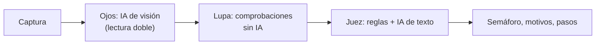

# 🛡️ Guardián

**ForgeHacks 2026 · Track Cybersecurity**

Guardián ayuda a adultos mayores de Perú a revisar mensajes, correos y páginas sospechosas. La persona sube una **captura de pantalla** y recibe un **semáforo** (🔴 peligro, 🟡 cuidado, 🟢 sin alertas), los **motivos** en lenguaje simple, una **analogía cotidiana**, los **pasos a seguir**, un botón para **escucharlo en voz alta** y otro para **avisar a su familia por WhatsApp**.

## Cómo funciona



1. **Ojos** (`app/api/analizar/route.js`): un modelo de visión transcribe la captura (tipo, marca, remitente, mensaje, enlaces).
   - Los enlaces se leen **dos veces con preguntas distintas**; solo se confirman los que coinciden.
   - En páginas web, la barra del navegador se recorta y se amplía (sharp) y se lee dos veces; se compara solo el dominio.
   - Filtros de código descartan remitentes copiados del propio mensaje y "enlaces" que no son direcciones.
2. **Lupa** (`lib/lupa.mjs`): código normal, sin IA. **Nunca visita el sitio sospechoso.**
   - Expande enlaces acortados consultando solo al acortador (bit.ly, t.ly…), con bloqueo de direcciones internas.
   - Separa el dominio real del subdominio (`appleid.987bf2.com` → `987bf2.com`).
   - Compara con el sitio oficial de la marca que dice ser.
   - Marca finales de dominio baratos (.top, .xyz…) como pista débil.
   - Consulta la antigüedad del dominio por RDAP.
3. **Juez** (`lib/juez.mjs`):
   - **Reglas**: calculan un *piso* de riesgo a partir de hechos comprobados (marca falsa, dominio nuevo, urgencia, petición de claves, número extranjero…).
   - **IA de texto**: redacta el veredicto en lenguaje simple. Puede **subir** el riesgo, pero **nunca bajarlo** por debajo del piso de reglas.
   - Si todos los modelos fallan, se entrega el veredicto de reglas con textos de respaldo: la app siempre responde.

Modelos (vía Featherless AI), con cadena de respaldo:
- Visión: `bakrianoo/arabic-legal-documents-ocr-1.0` → `autotrust/JEV-27B-VL`
- Juez: `unsloth/Llama-3.3-70B-Instruct` → `RedHatAI/Llama-3.3-70B-Instruct` → `Qwen/Qwen3-14B` → reglas

## Ejecutar

```bash
npm install
echo "FEATHERLESS_API_KEY=tu_clave" > .env.local
npm run dev   # http://localhost:3000
```

Probar lupa + juez sin visión:

```bash
node --env-file=.env.local scripts/probar-juez.mjs intrebonl.top/in/welc Interbank "Su cuenta fue bloqueada, active su token hoy" "+1 (972) 666-5699"
```

## Privacidad

- La captura se envía al servidor solo para este análisis y **no se guarda** (no hay base de datos).
- La lupa **no abre** los enlaces sospechosos: solo consulta al acortador y al registro público de dominios.
- El aviso a la familia lo envía la propia persona desde su WhatsApp; Guardián no guarda contactos.

## Qué probamos (y qué falló)

Probamos la lectura con **7 capturas reales** de estafas (SMS, correo y página web):

| Resultado | Casos |
|---|---|
| ✅ Lectura correcta (tipo, remitente y enlace) | 6 |
| ⚠️ Límite | 1 (remitente "RAPPI" no reconocido) |

Lupa + juez probados con: `intrebonl.top` (falso Interbank) → 🔴, `appleid.987bf2.com` (falso Apple) → 🔴, `www.interbank.pe` → 🟢.

No afirmamos que funcione siempre: son los casos que probamos.

## Límites conocidos

- **Lectura**: capturas sin cabecera no muestran remitente; los botones sin dirección visible no aportan enlace; la barra del navegador suele cortar la ruta (por eso solo usamos el dominio).
- **Marcas**: la lupa compara solo con las marcas de su lista (BCP, Interbank, Apple, SUNAT…). Si el mensaje dice ser de otra, lo dice y no adivina.
- **Dominio real**: se calcula con una regla simple para finales comunes (.com.pe, .gob.pe, .co.uk), no con la Public Suffix List completa.
- **Antigüedad**: depende de que el registro (RDAP) la publique; para .pe y .top a menudo no está disponible y la app lo dice.
- **Acortadores**: si no muestran el destino, se declara como señal en lugar de ocultarlo.
- **Disponibilidad de IA**: los modelos gratuitos a veces están saturados; por eso hay cadenas de respaldo y un veredicto por reglas.
- Guardián es una ayuda, **no una garantía**: ante la duda, verifica siempre por otro canal.

## Equipo

2 integrantes · construido durante ForgeHacks 2026 (3–10 de octubre).
